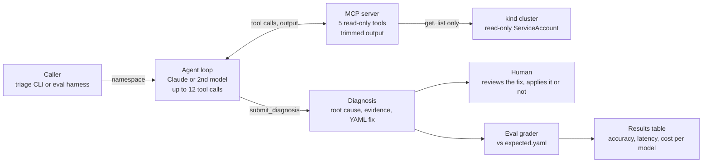

# Architecture

How cluster-triage-agent is put together. This file describes the design as it stands; when the design changes, update it here and record the reason in [DECISIONS.md](DECISIONS.md).

> **Built so far:** the template's provider adapter, agent loop, MCP server skeleton and eval harness; the six failure scenarios and the `triage-seed` seeder; `Category` and `ResourceRef` in `models.py`; the read-only RBAC in `deploy/rbac/` and its test; the MCP server's five Kubernetes tools with output trimming. `submit_diagnosis`, the `Diagnosis` model and the agent wiring below are the target design for Milestones 2–3. Until then `triage` and the offline eval gate still use the template's example tools.

## Overview

Four parts do the work: a caller, an agent loop, an MCP server, and the cluster. The model never talks to Kubernetes directly; every look goes through the MCP server, which can only read.



In real use a human reads the diagnosis; in evals the grader scores it.

## Request flow

1. The caller (the CLI, or the eval harness) passes a namespace and an optional alert message to the agent loop.
2. The agent loop asks the model what to check next. The model picks a tool.
3. The MCP server runs that tool against the cluster under the read-only ServiceAccount, trims the output, and returns it.
4. Steps 2–3 repeat until the model calls `submit_diagnosis` or hits the 12-call cap.
5. The diagnosis is validated against the Pydantic schema and its evidence quotes are checked against the real tool output.
6. The CLI prints a report for a human; the eval harness grades it against `expected.yaml` and logs latency and cost.

## MCP tools

Built in `src/triage/mcp_server/kube_server.py`; started with `triage-mcp --namespace <ns> --kubeconfig <agent kubeconfig>`.

| Tool | Arguments | Returns | Kubernetes access |
| --- | --- | --- | --- |
| `list_pods` | none | Each pod's phase, readiness, restarts, owner, and every container's current and last state (reason, exit code) | list pods |
| `get_events` | optional `kind`, `name` | Events newest first, at most 30, optionally for one object | list events |
| `get_logs` | `pod`, optional `container`, `previous`, `tail` | Last `tail` lines (default 100, max 200); `previous=true` for the run before a crash | get pods/log |
| `describe` | `kind`, `name` | One pod, deployment, replicaset, service, configmap, serviceaccount, role or rolebinding, trimmed. ConfigMaps show key names only; ServiceAccounts drop their Secret names; Services add a ready/not-ready endpoint count | get on those kinds, list endpointslices |
| `can_i` | `service_account`, `verb`, `resource`, optional `group`, `subresource` | Whether that ServiceAccount (in the run's namespace) may do it, from a SubjectAccessReview | create subjectaccessreviews |
| `submit_diagnosis` (M2) | the diagnosis | Ends the run with the structured diagnosis below | none |

How the server is put together:

- **One namespace per server.** `build_server(namespace, reader)` closes every tool over the namespace given at startup; no tool has a namespace argument (DECISIONS 020).
- **Identity check at startup.** `triage-mcp` asks the API server who it is (a SelfSubjectReview) and exits unless the answer is `system:serviceaccount:triage-system:triage-agent` (DECISIONS 020).
- **A reader interface.** Tools call a `KubeReader` (`kube.py`), never the client directly. `KubeClientReader` wraps the official Kubernetes Python client (DECISIONS 019) and returns the API's camelCase dicts; tests use a fake that serves `tests/fixtures/kube/`.
- **Trimming** (`trim.py`) drops `managedFields`, `resourceVersion`, `uid`, `generation` and the `last-applied-configuration` annotation, cuts log lines and event messages at 500 characters, and caps every result at 8,000 characters. Results are YAML, which costs fewer tokens than JSON.
- **Arguments are checked before any API call:** object names must be valid Kubernetes names, `kind` and `verb` come from fixed lists. Errors are raised as MCP `ToolError`s so the model sees the reason (for example `deployments "x" not found`).

## Security model

- The MCP server runs as the ServiceAccount `triage-system/triage-agent`, bound by a ClusterRoleBinding (DECISIONS 018) to the ClusterRole `triage-agent-read` in `deploy/rbac/`.
- That role has `get`, `list` and `watch` on pods, `pods/log`, events (core and `events.k8s.io`), services, configmaps, serviceaccounts, deployments, replicasets, endpointslices, roles and rolebindings, plus `create` on `subjectaccessreviews` for `can_i`. Nothing else.
- No access to Secrets. `tests/test_rbac.py` checks every rule against that allowlist and fails on write verbs, Secrets, wildcards, subresources like `pods/exec`, escalation verbs, `nonResourceURLs` and `aggregationRule` (DECISIONS 017), so a change to the role fails CI.
- Tools are scoped to one namespace per run, fixed when the server starts, never chosen by the model.
- The server refuses to start under any identity but the agent's ServiceAccount, so it can't run with admin credentials by mistake. Its kubeconfig holds a one-hour token for that ServiceAccount only.
- Everything from the cluster (logs, events, annotations) is untrusted data. Logs can contain text that looks like instructions; an M4 scenario tests this.

## Agent loop

- Short system prompt with the triage order: pod states, then events, then logs, then config and permissions.
- Up to 12 tool calls. On the cap, the agent must submit with low confidence rather than guess silently.
- Every run writes one JSON line with tool calls, tokens, latency and cost; the evals and README results table read from it.
- The model sits behind the provider adapter (`src/triage/providers/`), so swapping Claude for a second model is a config change.

## Diagnosis output

A Pydantic model, enforced through the `submit_diagnosis` tool schema:

| Field | Contents |
| --- | --- |
| `category` | One of CrashLoop, ImagePull, OOMKilled, ConfigError, ProbeFailure, RBACDenied, NetworkPolicy, Unknown |
| `affected_resource` | Kind and name |
| `root_cause` | One or two plain-English sentences |
| `evidence` | List of {tool, quoted line}; each quote is checked against the actual tool output |
| `proposed_fix` | Short explanation plus a YAML patch |
| `confidence` | 0 to 1 |

## Failure scenarios

Each scenario is a folder under `scenarios/NN-name/`. `manifest.yaml` creates a namespace `triage-NN-name` (labelled `triage.scenario`) and breaks exactly one thing in it. `expected.yaml` holds the right answer and the signal that the failure has shown:

```yaml
namespace: triage-04-missing-config
category: ConfigError
affected_resource: {kind: Deployment, name: billing}
also_accept:                      # other answers graded as right
  - {kind: ConfigMap, name: app-config}
description: Pod references a ConfigMap key that doesn't exist
seed:
  wait_for:                       # container_waiting | container_terminated | event | log_contains
    type: container_waiting
    reasons: [CreateContainerConfigError]
  timeout_s: 180                  # optional
```

| # | Folder | How it's seeded | Expected answer | Seeded when |
| --- | --- | --- | --- | --- |
| 1 | `01-crashloop` | busybox command logs an error and exits 1 | CrashLoop, Deployment/api | container waiting: CrashLoopBackOff |
| 2 | `02-imagepull` | `nginx:1.0.0-does-not-exist` | ImagePull, Deployment/web | waiting: ErrImagePull or ImagePullBackOff |
| 3 | `03-oomkilled` | `tail /dev/zero` under a 16Mi limit | OOMKilled, Deployment/worker | container terminated: OOMKilled |
| 4 | `04-missing-config` | env var from a ConfigMap key that doesn't exist | ConfigError, Deployment/billing (or ConfigMap/app-config) | waiting: CreateContainerConfigError |
| 5 | `05-failing-probe` | nginx on 80, readiness probe on 8080 | ProbeFailure, Deployment/frontend | event: Unhealthy |
| 6 | `06-rbac-denied` | curl reads a ConfigMap with a ServiceAccount that has no Role; keeps running | RBACDenied, ServiceAccount/reporter (or Deployment/reporter) | logs contain "is forbidden" |
| 7 (M4) | | NetworkPolicy denies traffic from the frontend | NetworkPolicy | |
| 8 (M4) | | Two problems at once, or a misleading log line | the real one | |

Pinned public images only (busybox, nginx, curlimages/curl), each container with a memory limit, no Secrets.

### Seeding

`triage-seed` (`src/triage/scenarios.py`) is test-harness code, separate from the agent. It runs `kubectl` with your own context, so it can create and delete, and it refuses any context that isn't `kind-*`. `apply` runs `kubectl apply -f`, then polls `get pods`, `get events` or `logs` until the `wait_for` signal shows or the timeout passes. `delete` removes the scenario's namespace. `check` does both for each scenario and reports how long each failure took to show.

## Evals

| Metric | How it's measured |
| --- | --- |
| Root-cause accuracy | `category` and `affected_resource` match `expected.yaml` |
| Evidence grounding | Share of quoted evidence lines found in the real tool output |
| Fix validity (M4) | Patch passes a server-side dry run, then the pod becomes Ready after applying it |
| Latency | p50 and p95 seconds per incident |
| Cost | Dollars per incident from token counts and `config/pricing.json` |
| Tool calls | Average calls per incident, and how often the cap was hit |

Each scenario runs 3 times per model. Unit tests and CI use recorded tool output in `tests/fixtures/` and never call a model or need a cluster; real evals run on demand.

## Repo layout

```
cluster-triage-agent/
  CLAUDE.md            how Claude Code works in this repo
  README.md            overview and progress tracker
  ARCHITECTURE.md      this file
  DECISIONS.md         decision log
  src/triage/
    mcp_server/        kube_server.py (5 read-only tools), kube.py (reader), trim.py; server.py = template example until M2
    agent/             loop, system prompt, tool-call cap
    models.py          Category, ResourceRef; Diagnosis schema in M2
    scenarios.py       triage-seed: seed, wait for, delete scenarios
    providers/         adapter: Claude + one comparison model
    evals/             eval runner
    cli.py             triage --namespace <ns>
  deploy/rbac/         ServiceAccount, read-only ClusterRole, binding
  scenarios/NN-name/   manifest.yaml + expected.yaml
  evals/               cases, baseline, results
  tests/               offline unit tests and fixtures
  .github/workflows/   lint, types, tests and eval gate on every push and PR
```

## Tech stack

| Layer | Choice |
| --- | --- |
| Language and packaging | Python 3.12, uv |
| Agent tools | Official MCP Python SDK |
| Cluster access | Kubernetes Python client |
| Models | Anthropic SDK (Claude) plus one comparison model through the adapter |
| Schemas | Pydantic |
| Local cluster | `kind` (Kubernetes in Docker), in CI too |
| Quality | pytest, Ruff, mypy, pre-commit |
| CI | GitHub Actions |
| Tracing (M4) | Arize Phoenix, self-hosted |
