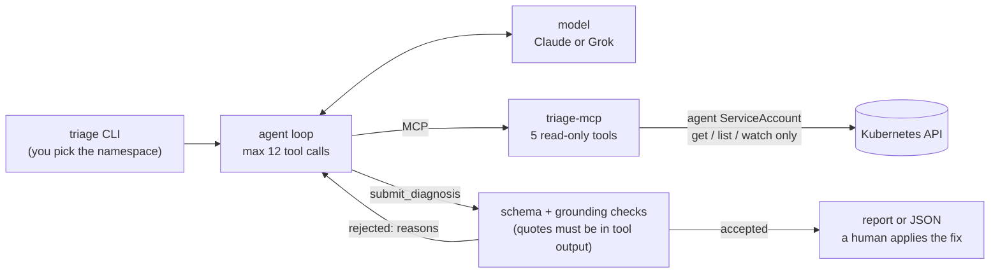

# cluster-triage-agent

[](https://github.com/alysondelledonne/cluster-triage-agent/actions/workflows/ci.yml)

An AI agent that takes a broken Kubernetes namespace and returns the root cause, the evidence it used, and a proposed YAML fix. It looks at the cluster only through read-only tools on an MCP server, enforced by RBAC, and a human decides whether to apply the fix.


**Status:** Milestones 0–3 done (2026-10-22): the agent, six seeded failure scenarios, evals comparing two models, CI, and this README. Next is Milestone 4: checking that fixes actually work, more scenarios, and tracing.

- How it works: [ARCHITECTURE.md](ARCHITECTURE.md)
- Why it works that way: [DECISIONS.md](DECISIONS.md) (47 numbered decisions)
- Every eval run and every anomaly in it: [evals/RESULTS.md](evals/RESULTS.md)

## Results

Six seeded failure scenarios, recorded from a real kind cluster and replayed so every run sees the same cluster output, 3 runs per scenario per model. These are the two runs with the current prompt (version 2); Run 5 ran on a GitHub runner from the [`eval-live.yml`](.github/workflows/eval-live.yml) workflow.

| run | model | correct | first-try grounding | tool calls / run | latency p50 / p95 | cost / incident |
| --- | --- | --- | --- | --- | --- | --- |
| 4 | `claude-haiku-5-5` | 18/18 | 1.00 | 3.8 | 5.9s / 9.5s | $0.0023 |
| 4 | `grok-4.20-0309-non-reasoning` | 18/18 | 0.98 | 4.8 | 6.0s / 16.1s | $0.024 |
| 5 | `claude-haiku-5-5` | 18/18 | 1.00 | 3.8 | 5.5s / 6.8s | $0.0022 |
| 5 | `grok-4.20-0309-non-reasoning` | 18/18 | 0.97 | 4.9 | 6.1s / 16.1s | $0.026 |

- **Correct** means the right category and the right object to fix, graded against each scenario's `expected.yaml`.
- **First-try grounding** is the share of quotes in the agent's first submission that were found in the output of the tool it named. Quotes that aren't found are rejected and sent back, so a report only ever shows real ones.
- **Both models are equally accurate with the current prompt; Haiku costs about a tenth as much**, so it's the default. Grok is as fast on simple scenarios but explores more on the RBAC one (10–12 tool calls against 5).
- Getting here took five runs: the first ones exposed bugs in the measuring tools and the agent loop, and one prompt change, measured before and after, removed Grok's last misdiagnosis. That history is under [Milestone 3](#milestone-3-evals-ci-and-readme--done-2026-10-22).

To reproduce the table, run the evals locally (`uv run triage-eval --provider anthropic --provider grok --repeats 3 --save`, about $0.50) or from the Actions tab of a fork ([how](#run-the-evals-yourself)).

## Why another triage tool

[k8sgpt](https://github.com/k8sgpt-ai/k8sgpt) and [HolmesGPT](https://github.com/robusta-dev/holmesgpt) already use LLMs to explain cluster problems. This project is narrower and focuses on two things:

- **Read-only by construction.** Every capability is an MCP tool running under a ServiceAccount with `get`, `list` and `watch` only (plus `create` on `subjectaccessreviews`), and a test fails CI if the role ever gains a write verb or Secrets access.
- **Measured.** A suite of seeded failure scenarios scores root-cause accuracy, evidence grounding, latency and cost per incident, comparing two models, and every answer's evidence is checked against what the cluster actually said.

## How it works



1. You name the namespace; the model never chooses it.
2. The model investigates with five read-only tools: `list_pods`, `get_events`, `get_logs`, `describe` and `can_i`. Their output is trimmed and treated as untrusted data.
3. It finishes only by calling `submit_diagnosis` with a category, the object to fix, the root cause, quoted evidence, a YAML fix and a confidence. A submission whose quotes aren't in the tool output, or whose fix touches Secrets, cluster-wide objects or another namespace, goes back to the model with the reasons.
4. After 12 tool calls the next turn requires a submission.

The details, including the security model and the eval metrics, are in [ARCHITECTURE.md](ARCHITECTURE.md).

## Runbook

### Prerequisites

- [uv](https://docs.astral.sh/uv/) (it installs Python 3.12 for you)
- Docker, [kind](https://kind.sigs.k8s.io/) and `kubectl` 1.28 or newer, only for a live cluster. CI uses kind v0.33.0 with Kubernetes v1.37.0, the version the recordings were made on.
- An Anthropic API key for real runs. A Grok key is only needed to compare models: it must be a "Grok Interface" API key from [console.x.ai](https://console.x.ai), with prepaid credits, not a grok.com subscription.

### 1. Offline: no cluster, no key, no cost

```bash
git clone https://github.com/alysondelledonne/cluster-triage-agent.git
cd cluster-triage-agent
uv sync
uv run pre-commit install                   # ruff, mypy and a gitleaks secrets check before each commit
uv run pytest                               # every test is offline; the network is blocked
uv run triage-eval --provider fake --gate   # the eval pipeline with a scripted model
```

### 2. Diagnose a recording (costs about $0.002)

```bash
cp .env.example .env                        # then set ANTHROPIC_API_KEY
uv run triage --replay tests/fixtures/scenarios/06-rbac-denied/recording.json
```

`--replay` serves a recorded cluster through the real tools, so no cluster is needed. The report shows the category and affected object, the root cause, each evidence quote with the tool it came from, the proposed fix as YAML, then one line with the run's tool calls, tokens, time and cost. Exit code 0 means a diagnosis was submitted, 1 that the agent didn't submit one, 2 a setup problem. Every run is appended to `runs/runs.jsonl` with the prompt version and the full trace.

### 3. A live kind cluster

```bash
kind create cluster --name triage
kubectl --context kind-triage apply -f deploy/rbac/   # the agent's read-only ServiceAccount
kubectl --context kind-triage auth can-i --list \
  --as=system:serviceaccount:triage-system:triage-agent   # reads only; no secrets, no writes
scripts/agent-kubeconfig.sh                          # ~/.kube/triage-agent.yaml, the agent's token only
uv run triage-seed list                              # the six scenarios
uv run triage-seed apply 1                           # break something, wait for the failure to show
uv run triage --namespace triage-01-crashloop
uv run triage --namespace triage-01-crashloop --alert "api pods keep restarting" --json
uv run triage-seed delete 1
```

[`scripts/agent-kubeconfig.sh`](scripts/agent-kubeconfig.sh) copies the cluster from your `kind-triage` context, removes your own credentials from the copy, adds a one-hour token for `triage-system/triage-agent`, and checks the result authenticates as that ServiceAccount; it ends with `wrote …/triage-agent.yaml: system:serviceaccount:triage-system:triage-agent, token valid for 1h`. Run it again when the token expires (`--context`, `--output` and `--duration` change the defaults). `triage --namespace` refuses to run as anyone else.

`triage-seed` only works on kind contexts (`kind-…`), so it can't break a real cluster by accident. `triage-seed check` seeds every scenario, waits for each failure and cleans up.

### 4. Use the tools from Claude Desktop or Claude Code

```bash
uv run triage-mcp --namespace triage-01-crashloop --kubeconfig ~/.kube/triage-agent.yaml
```

The server reads one namespace, fixed when it starts, and refuses to start unless it is connected as the agent's ServiceAccount. It waits for an MCP client on stdin and stdout; add it to Claude Desktop or Claude Code as a stdio server with that same command.

### 5. Evaluate

`triage-eval` runs every scenario from its recording, grades each run against the scenario's `expected.yaml`, and prints a summary per model and a scenario-by-model grid. Real runs cost about $0.04 for 18 Haiku runs and about $0.45 for 18 Grok runs.

```bash
uv run triage-eval --provider fake --gate
uv run triage-eval --provider anthropic --repeats 3 --save
uv run triage-eval --provider anthropic --provider grok --repeats 3 --save
```

`--save` writes every run and the summaries to `evals/results/` and the tables to `evals/results/latest.md`. Grok needs `XAI_API_KEY` and `XAI_MODEL` in `.env` (see `.env.example`).

### 6. Re-record the scenarios

After changing a scenario, re-record it so the offline tests and evals replay what a real cluster says. `triage-seed record` seeds each scenario, waits for the failure plus 15 seconds, reads everything the tools could ask for through the agent's kubeconfig, saves the raw API responses to `tests/fixtures/scenarios/NN-name/recording.json`, and deletes the scenario.

```bash
scripts/agent-kubeconfig.sh
uv run triage-seed record
uv run pytest
```

### 7. Clean up

```bash
kind delete cluster --name triage
rm ~/.kube/triage-agent.yaml
```

### Troubleshooting

| symptom | cause and fix |
| --- | --- |
| `triage --namespace` fails with `401` or `Unauthorized` | The agent's token lasts an hour. Run `scripts/agent-kubeconfig.sh` again. |
| `triage` says `refusing to run`, or `triage-mcp` won't start, naming another user | You passed your own kubeconfig. Use `--kubeconfig ~/.kube/triage-agent.yaml` (the default for `triage`). |
| `triage-seed` refuses the context | It only works on `kind-…` contexts by design. Pass `--context kind-<name>` for another kind cluster. |
| A scenario times out while seeding | Usually a slow image pull. Retry, or pass `--timeout` with more seconds. |
| Grok: `Incorrect API key provided` | The key must be a "Grok Interface" API key from console.x.ai with prepaid credits; keys from grok.com don't work with the API. |
| `No model set for provider 'grok'` | Set `XAI_MODEL` in `.env` (or the repository variable in CI). |
| A test fails with `tests must not use the network` | The test tried to reach a model API or cluster. Use the fake providers and the recordings in `tests/fixtures/`. |
| The `secrets` CI job or the gitleaks pre-commit hook reports a leak | If it's a real key, revoke it with the provider first, then remove it from the history; deleting it in a new commit isn't enough. If it's a false positive (a fake test token, a pod name), add the fingerprint gitleaks prints to `.gitleaksignore`. |
| Exit code 1 from `triage` | The agent didn't submit an accepted diagnosis; the report shows the last thing the model said. Exit code 2 is a setup problem (key, kubeconfig, recording path). |

### CI

Three GitHub Actions workflows (DECISIONS 045). Every action is pinned to a commit, and Dependabot proposes updates weekly.

| workflow | runs | what it does | cost |
| --- | --- | --- | --- |
| [`ci.yml`](.github/workflows/ci.yml) | every push to `main` and every PR | ruff, shellcheck, mypy, pytest, the offline eval gate, and a gitleaks scan of the whole git history | free; no secrets, and the tests can't reach the network |
| [`kind.yml`](.github/workflows/kind.yml) | by hand, and Mondays | creates a kind cluster, seeds and records all six scenarios through the agent's ServiceAccount, runs the recording tests and the gate on the fresh recordings, uploads them | free; optionally diagnoses each namespace live with one model (a few cents) |
| [`eval-live.yml`](.github/workflows/eval-live.yml) | by hand only | the real evals on the committed recordings; tables in the run summary, results as an artifact | about $0.50 for both models at 3 repeats |

#### Run the evals yourself

1. Fork the repo.
2. In the fork's Settings → Secrets and variables → Actions, add the secrets `ANTHROPIC_API_KEY` and `XAI_API_KEY`, and the variable `XAI_MODEL` (`grok-4.20-0309-non-reasoning` for the results here). `ANTHROPIC_MODEL` is optional and defaults to `claude-haiku-5-5`. Only the providers you run need their key.
3. Actions → **Live eval (manual)** → Run workflow. The defaults (`anthropic grok`, 3 repeats, all scenarios) reproduce the results table below.
4. The run's summary page shows the same tables as `triage-eval`; the `eval-results` artifact holds the results file and every run's trace. The workflow never commits.

## Known failure modes

What the evals and hand runs have shown so far, and what the agent can't do yet. Run IDs in [evals/RESULTS.md](evals/RESULTS.md) show each one.

**What the models get wrong**

- **Quotes built from several lines.** Grok sometimes joins separate lines of tool output into one quote, most often an event's `type`, `reason` and `message`, the way `kubectl get events` prints them. The grounding check rejects these and the retry usually fixes it, but it costs a turn, and before prompt version 2 it twice cost the whole diagnosis.
- **Over-exploring.** On the RBAC scenario Grok makes 10–12 tool calls where 5 are enough, looking for Roles that the API has already said don't exist. It once used all 12 and submitted on the forced last turn.
- **Incomplete first submissions.** Haiku leaves out `confidence` or `proposed_fix`, or writes a root cause over 600 characters, in about 1 in 6 first submissions. The schema rejects them and the retry is accepted.
- **CrashLoop or ConfigError.** A container that starts and then exits because a setting is missing is CrashLoop; Grok called it ConfigError in 2 of 6 runs until prompt version 2 drew the line. Watch for it on new scenarios.

**What the agent can't do yet**

- **Fixes aren't tested.** The checks make sure a fix is well-formed YAML in the right namespace that touches no Secrets or cluster-wide objects, not that it works. A plausible fix that changes nothing would pass. Milestone 4 adds a server-side dry run and checks that the pod recovers.
- **Applying a fix.** Fixes hold only the fields that change. Plain client-side `kubectl apply` on such a partial object can delete fields the original `kubectl apply` set; use `kubectl patch` or `kubectl apply --server-side`, and review the fix first (DECISIONS 030).
- **Only common objects.** `describe` covers Pods, ReplicaSets, Deployments, Services, ConfigMaps, ServiceAccounts, Roles and RoleBindings. StatefulSets, DaemonSets, Jobs and operator-managed workloads aren't followed to their owner yet, and there are no NetworkPolicy reads, so the NetworkPolicy category can't be confirmed. OpenShift-specific failures such as security-context-constraint denials have no category.
- **Previous logs can be missing.** For a restarting container the kubelet sometimes answers `unable to retrieve container logs`; the agent then has to reason from the script or events, and says so.
- **Prompt injection is only partly covered.** The prompt says cluster output is data, never instructions, but no scenario tests a log that tries to steer the agent yet (Milestone 4). The real protection is RBAC: even a fooled agent can only read.

**What the evals don't show**

- Six synthetic scenarios with one clear cause each, 3 runs per scenario per model. Grok's score has moved between 15/18 and 18/18 across runs with no change to how it diagnoses, so one run more or less is noise.
- Replayed recordings give every run identical cluster output. The weekly kind workflow checks the recordings still match a real cluster, but real incidents are messier.

## How I built this with Claude Code

I built this with Claude Code as a pair programmer. I set the design, the order of work and the rules; Claude proposed plans, wrote tests and code, and kept the docs current; I reviewed and ran everything, and made every commit myself.

- **[CLAUDE.md](CLAUDE.md) holds the rules that don't bend:** the agent is read-only, no Secrets, the caller picks the namespace, cluster output is untrusted, tests never call a model or need a cluster, and the eval baseline never gets lowered to make CI pass. It also sets how we work: propose a plan before anything bigger than a small fix, write the tests first, and update DECISIONS, ARCHITECTURE and this README in the same commit as the change.
- **Plan, approve, test, build.** Each step started with a plan I approved or changed. Choices that were mine to make came as explicit questions: for example, recording raw API responses rather than tool output (DECISIONS 022), Grok as the comparison model (034), rerunning the "before" after fixing the harness rather than saving the money (040), and running the kind job weekly with actions pinned to commits (045).
- **Tests first, every time,** then the code, then the full check (ruff, mypy, pytest, the offline eval gate) before anything was called done. Then I ran the checks again on my machine, read the diff and committed.
- **Guardrails that don't rely on trusting the AI:** a test that fails if the RBAC role gains a write verb or Secrets access, a test fixture that blocks the network so no test can quietly call a model or a cluster, the offline eval gate in CI, and the grounding check that rejects any quote not found in real tool output.
- **Reading every anomaly by run ID** is where most of the learning came from. The first runs exposed flaws in my own measuring tools (a grounding check that mishandled `\n` escapes, recordings missing objects a real cluster has, metrics that undercounted, a re-check that read submissions differently from the agent), a gap in the agent loop (the forced last turn didn't require the tool call), and a schema message that led a model to invent a placeholder fix. Each one has a DECISIONS entry saying what was wrong and what changed.
- **[DECISIONS.md](DECISIONS.md) is the project's memory:** 47 numbered entries, each with why and what follows. Old entries are never rewritten; a later one supersedes them.

## Progress

Milestones 1–3 are the MVP. Each milestone ends in something that runs and is committed.

### Milestone 0: Setup — done 2026-10-20

- [x] Policy check, personal Anthropic API key with a monthly spend cap (comparison-model key deferred to M3)
- [x] Repo created from ai-project-template; package renamed to `triage`
- [x] Docker, `kind` and `kubectl` installed; `kind-triage` cluster running (Kubernetes v1.37.0)
- [x] CLAUDE.md with the goal, the read-only rule, "write tests first", and the commands

**Done when:** CI is green on an empty project and `kubectl get nodes` works against kind. ✅

### Milestone 1: Broken cluster and read-only tools — done 2026-10-20

- [x] Scenarios 1–6 as manifests plus `expected.yaml`, each in its own namespace
- [x] Script that applies a scenario, waits until the failure shows, and deletes it afterward (`triage-seed`)
- [x] All six scenarios verified on `kind-triage` with `triage-seed check` (2026-10-20)
- [x] RBAC manifests and a test that fails if the ClusterRole gains a write verb or Secrets access
- [x] MCP server with the five read tools, running under that ServiceAccount
- [x] Output trimming (log line cap, managed fields removed)
- [x] Each tool's real output per scenario recorded into `tests/fixtures/` (`triage-seed record`)
- [x] Server connected to Claude and one scenario triaged by chatting, as a sanity check (scenario 6, Claude desktop app)

**Done when:** all six scenarios seed reliably, every tool has tests, and a scenario can be diagnosed by hand through the MCP server. ✅

### Milestone 2: The agent — done 2026-10-21

- [x] `Diagnosis` Pydantic model and the `submit_diagnosis` tool
- [x] Loop calling tools through the MCP client, with the tool-call cap and a required submission
- [x] System prompt with the triage order (pods, events, logs, config, permissions)
- [x] Every run logged to JSON lines: tool calls, tokens, latency, cost
- [x] CLI: `triage --namespace demo-crashloop` prints a readable report
- [x] Evidence quotes checked against the real tool output
- [x] At least 4 of 6 scenarios right by hand; misses noted

**Done when:** one command diagnoses any scenario and prints root cause, evidence and a proposed fix. ✅

Hand runs, 2026-10-21, `claude-haiku-5-5`, prompt version 1, one run each (scenario 1 live, the rest replayed from recordings):

| Scenario | Diagnosis | Right? | Confidence | Tool calls | Cost |
| --- | --- | --- | --- | --- | --- |
| 01-crashloop | CrashLoop, Deployment/api | ✅ | 0.80 | 4 | $0.0020 |
| 02-imagepull | ImagePull, Deployment/web | ✅ | 0.95 | 3 | $0.0020 |
| 03-oomkilled | OOMKilled, Deployment/worker | ✅ | 0.90 | 3 | $0.0018 |
| 04-missing-config | ConfigError, Deployment/billing | ✅ | 0.93 | 4 | $0.0019 |
| 05-failing-probe | ProbeFailure, Deployment/frontend | ✅ | 0.90 | 4 | $0.0020 |
| 06-rbac-denied | RBACDenied, ServiceAccount/reporter | ✅ | 0.93 | 5 | $0.0027 |

No misses. One run each is not a measurement; Milestone 3 runs each scenario 3 times per model. What the runs did show is in DECISIONS 030: the scenario 1 and 3 fixes can't work as the scenarios are written, and partial-object fixes need a safer way to apply than plain `kubectl apply`.

### Milestone 3: Evals, CI and README — done 2026-10-22

- [x] `run_evals`: for each scenario and model, seed, triage 3 times, grade, reset (`triage-eval`, replaying the recordings instead of seeding each run: DECISIONS 033)
- [x] Accuracy, evidence grounding, p50/p95 latency, cost per incident and tool calls in a results table
- [x] Claude vs the comparison model; which wins on accuracy, cost and speed
- [x] One change made from the results, with before and after (prompt version 2: Run 3 → Run 4, DECISIONS 043–044)
- [x] GitHub Actions: checks on every PR; a manual workflow that spins up kind and runs the evals (`ci.yml`, `kind.yml`, `eval-live.yml`; first runs 2026-10-22, DECISIONS 045–046)
- [x] README: results table, runbook, known failure modes, "How I built this with Claude Code" (this page; DECISIONS 047)
- [x] Demo GIF of the CLI diagnosing a scenario ([`docs/demo.gif`](docs/demo.gif), recorded from [`docs/demo.tape`](docs/demo.tape))

**Done when:** a stranger can clone the repo, follow the README, and reproduce the results table. ✅ Run 5 reproduced it from the `eval-live.yml` workflow on a GitHub runner.

Real evals so far, 3 runs per scenario per model, replayed from the recordings ($0.46–0.55 each). Runs 1–3 use prompt version 1, Runs 4 and 5 version 2; Run 5 ran on GitHub Actions through `eval-live.yml`. Run 2 is Run 1 rerun after fixing two flaws in the measuring tools (DECISIONS 038). Run 3 adds the loop and metric fixes (040–042) and is the "before" for prompt version 2; from Run 3 on, first-try grounding leaves out runs that never submitted. Details, per-scenario numbers and every anomaly by run: [evals/RESULTS.md](evals/RESULTS.md).

| run | model | accuracy | first-try grounding | tool calls / run | latency p50 / p95 | cost / incident |
| --- | --- | --- | --- | --- | --- | --- |
| 1 | `claude-haiku-5-5` | 18/18 (1.00) | 1.00 | 3.9 | 6.1s / 8.4s | $0.0022 |
| 1 | `grok-4.20-0309-non-reasoning` | 17/18 (0.94) | 0.92 | 5.3 | 5.0s / 15.4s | $0.028 |
| 2 | `claude-haiku-5-5` | 18/18 (1.00) | 1.00 | 4.0 | 6.5s / 9.2s | $0.0023 |
| 2 | `grok-4.20-0309-non-reasoning` | 15/18 (0.83) | 0.83 | 5.4 | 5.5s / 17.0s | $0.028 |
| 3 | `claude-haiku-5-5` | 18/18 (1.00) | 0.99 | 3.8 | 6.1s / 10.3s | $0.0024 |
| 3 | `grok-4.20-0309-non-reasoning` | 17/18 (0.94) | 1.00 | 4.8 | 6.7s / 14.8s | $0.023 |
| 4 | `claude-haiku-5-5` | 18/18 (1.00) | 1.00 | 3.8 | 5.9s / 9.5s | $0.0023 |
| 4 | `grok-4.20-0309-non-reasoning` | 18/18 (1.00) | 0.98 | 4.8 | 6.0s / 16.1s | $0.024 |
| 5 | `claude-haiku-5-5` | 18/18 (1.00) | 1.00 | 3.8 | 5.5s / 6.8s | $0.0022 |
| 5 | `grok-4.20-0309-non-reasoning` | 18/18 (1.00) | 0.97 | 4.9 | 6.1s / 16.1s | $0.026 |

Haiku wins on accuracy, evidence and cost (about 13x cheaper); Grok is faster on simple scenarios but slower on the two hardest. Grok's one miss (scenario 5) had the right fix, but its submissions kept quoting lines joined together that aren't adjacent in the output, so none was accepted. The run also exposed two flaws in the measuring tools, `\n` escapes in grounding and objects missing from the recordings, which are fixed before the before-and-after for prompt version 2 (DECISIONS 037).

Run 2 confirmed the measurement fixes (no unrecorded calls, no quote rejected for escaping; Haiku unchanged). Grok lost two scenario 6 runs in an identical way: given the API's real `not found` for the missing Role, it kept searching until the 12-call cap, then wrote the right diagnosis as plain text on the forced last turn. The loop offers only `submit_diagnosis` there but doesn't require the call, which is a gap in the loop that gets fixed before prompt version 2 (DECISIONS 039). Its scenario 1 miss was the same joined-quote habit as Run 1.

Run 3 had no cap hits and no quoting failures from Grok (first-try grounding 1.0). Its one miss was scenario 1 again, called ConfigError although the prompt defines that as a container that never starts. Haiku stayed at 18/18, with one quote missing a quote mark and two submissions that left out required fields, all corrected on retry.

**The one change: prompt version 2** (Run 3 before, Run 4 after; DECISIONS 043–044). It asks for one-line quotes, never joined or annotated, and draws the line between CrashLoop and ConfigError. Grok's scenario 1 misreading (ConfigError in 2 of 6 runs before) disappeared: 3/3 CrashLoop, in 4 calls instead of 5–6. The quoting rule showed no measurable effect, because Run 3 had no joined quotes left to fix. Both models scored 18/18 after the change. The first real cap hit since the forced-turn fix ended in a correct diagnosis instead of plain text.

| | Haiku before → after | Grok before → after |
| --- | --- | --- |
| accuracy | 18/18 → 18/18 | 17/18 → 18/18 |
| scenario 1 | 3/3 → 3/3 | 2/3 → 3/3 |
| first-try grounding | 0.99 → 1.00 | 1.00 → 0.98 |
| cost per incident | $0.0024 → $0.0023 | $0.023 → $0.024 |

Run 5 repeated Run 4 from the `eval-live.yml` workflow on a GitHub runner: both models 18/18 again. Grok's remaining quote rejections there joined an event's `type`, `reason` and `message` lines into the single line `kubectl get events` would print, which the tool doesn't; noted for after Milestone 3.

### Milestone 4: Make it stronger

- [ ] Fix validity: server-side dry run, then apply in the eval cluster and check the pod becomes Ready
- [ ] Scenarios 7 (NetworkPolicy) and 8 (red herring), plus a log-injection scenario
- [ ] Phoenix tracing and a write-up of one failed run debugged from its trace
- [ ] Optional: read-only run against the homelab cluster
- [ ] Blog post: what broke, what the evals showed, model comparison

## License

Apache-2.0. This is a personal project. It is not affiliated with, endorsed by, or representative of my employer.
